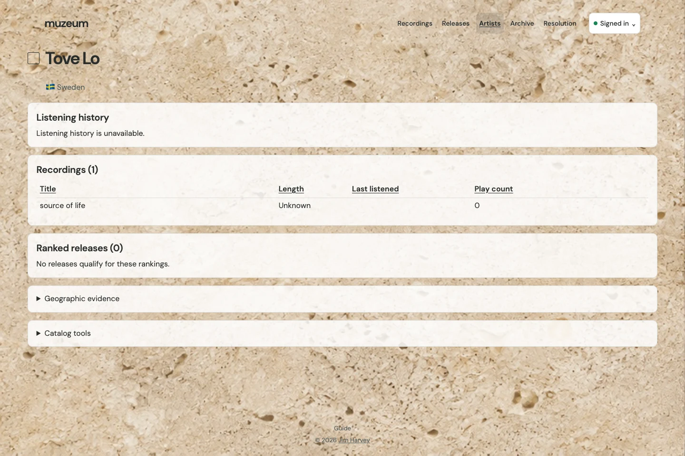
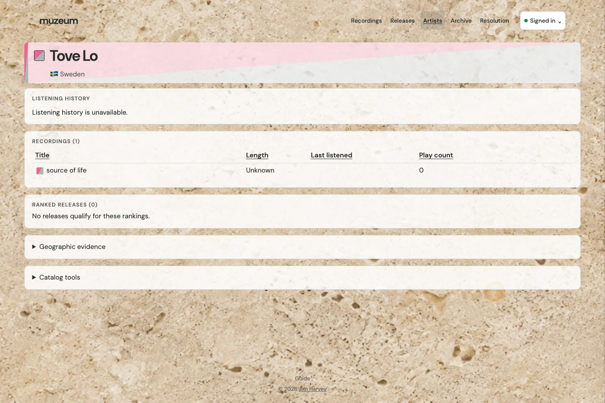

# Muzeum v0.6.7 design review

Artist, Recording, and Release headings use compact cards with a tint and right-edge accent drawn from the effective musical colors. Two-color palettes split on a sharp diagonal. Neutral badges use a subtle slash, and supporting dates, credits, and country labels sit closer to the title.

Recording Resolution shows the full original tracklist inline. Numbers run from 1 through 15 for *Charli*, across both media. The preview groups planned changes by entity type, with source details available in Evidence.

Chrome captures use local fixtures with 1440 × 960 desktop and 390 × 844 mobile viewports. Resolution captures cover the full page. The comparison is against the staged v0.6.6 design. The assigned Artist and Release examples show the color treatment, while the Recording examples compare the neutral badges.

| View | Before | After |
| --- | --- | --- |
| Tove Lo · desktop light |  |  |
| “source of life” · desktop light | [Recording heading](recording-before-desktop-light.webp) | [Recording heading with neutral badge](recording-after-desktop-light.webp) |
| *ESTRUS* · mobile dark | [Release heading](release-before-mobile-dark.webp) | [Release heading with inherited colors](release-after-mobile-dark.webp) |
| *Charli* Resolution · desktop light | [Tracklist and preview](resolution-before-desktop-light.webp) | [Sequential tracklist and grouped preview](resolution-after-desktop-light.webp) |
| *Charli* Resolution · mobile dark | [Tracklist and preview](resolution-before-mobile-dark.webp) | [Sequential tracklist and grouped preview](resolution-after-mobile-dark.webp) |
