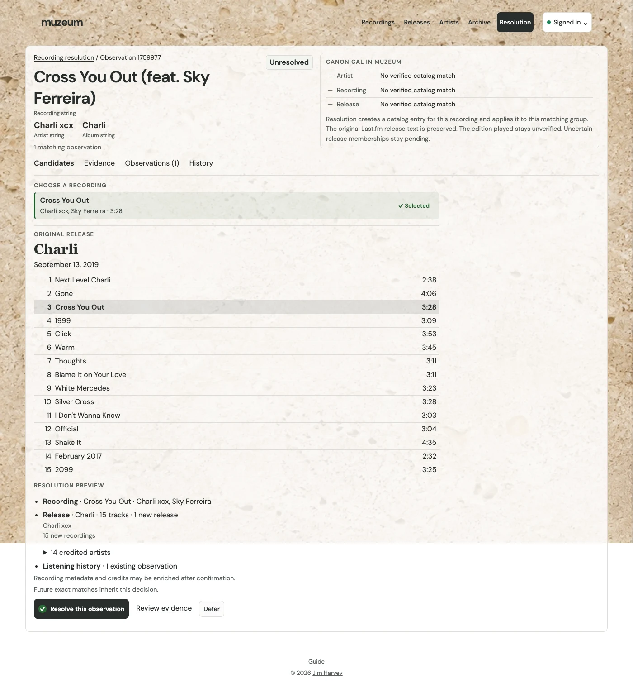
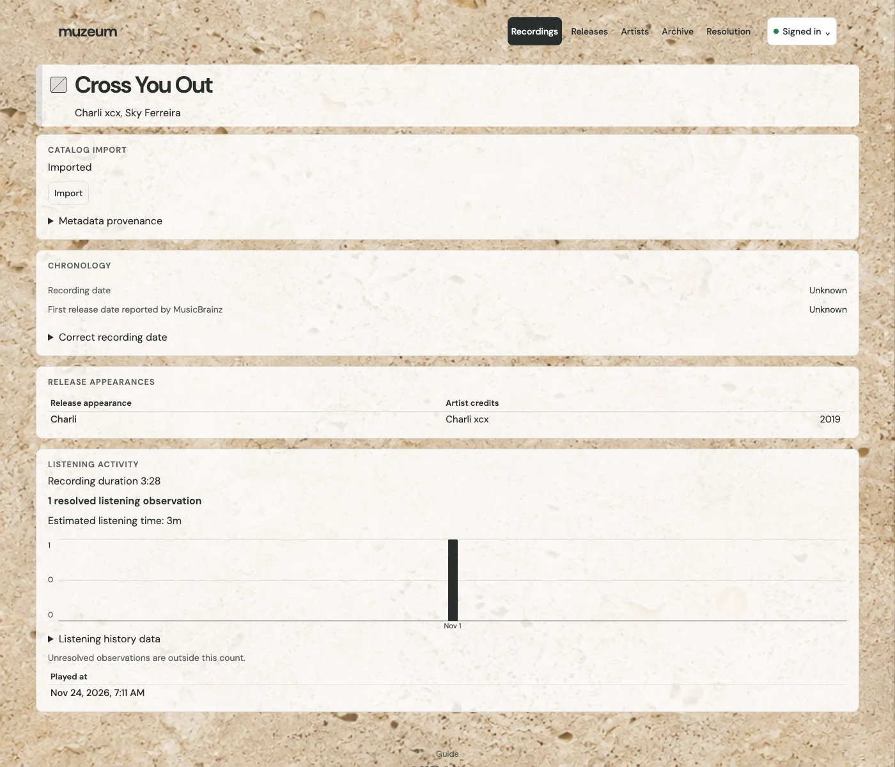

# Featured-artist discovery and ordered credits

The browser replay uses the MusicBrainz evidence for Cross You Out. Resolution retains the Last.fm title as observed and displays the candidate’s two artist credits in source order. The proposed album has its own artist credit.

The recording page links each artist in the same order.

